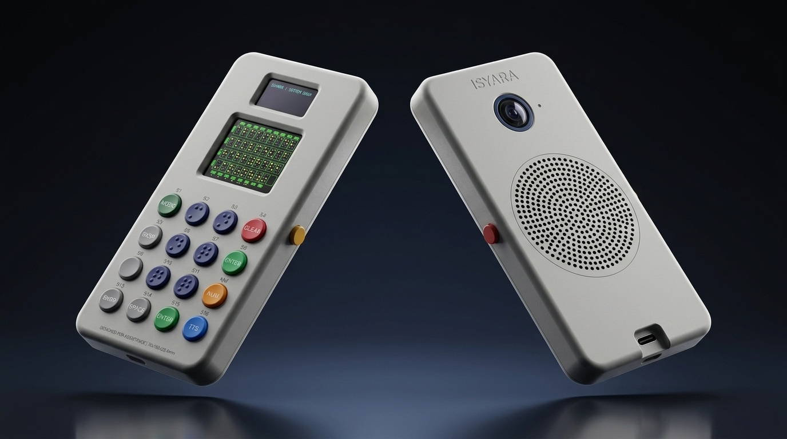
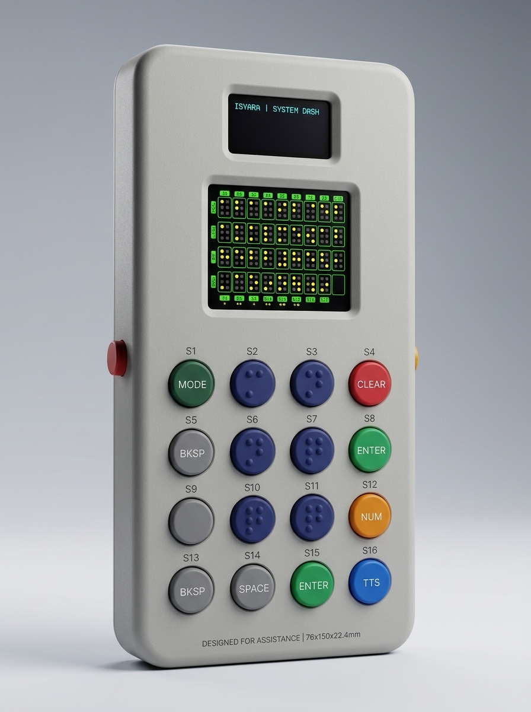
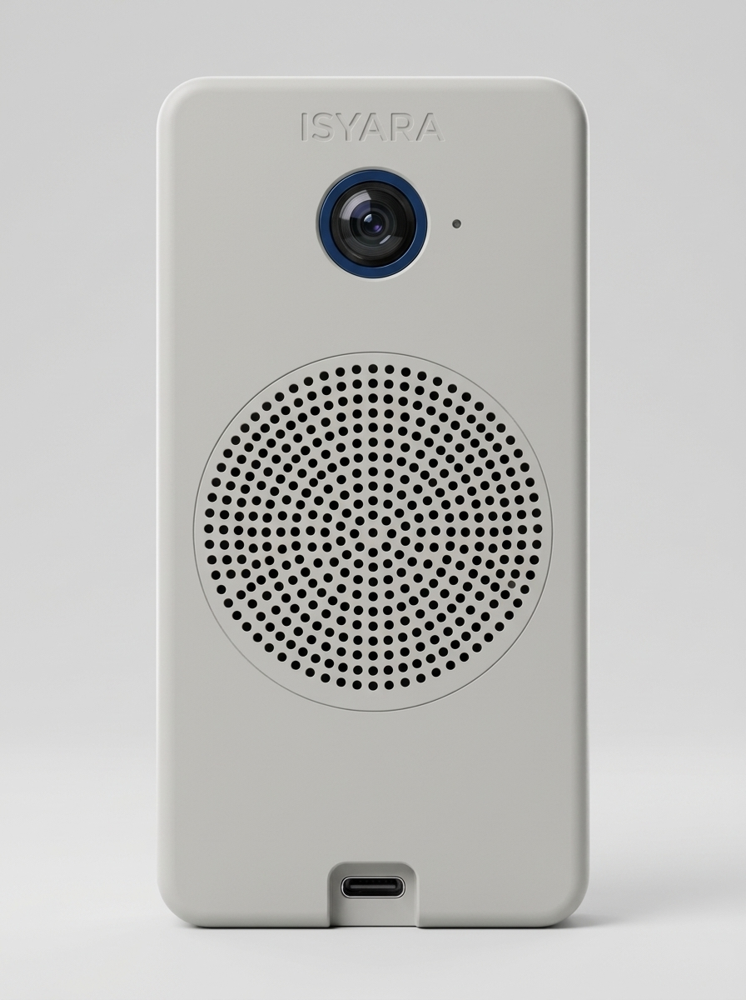
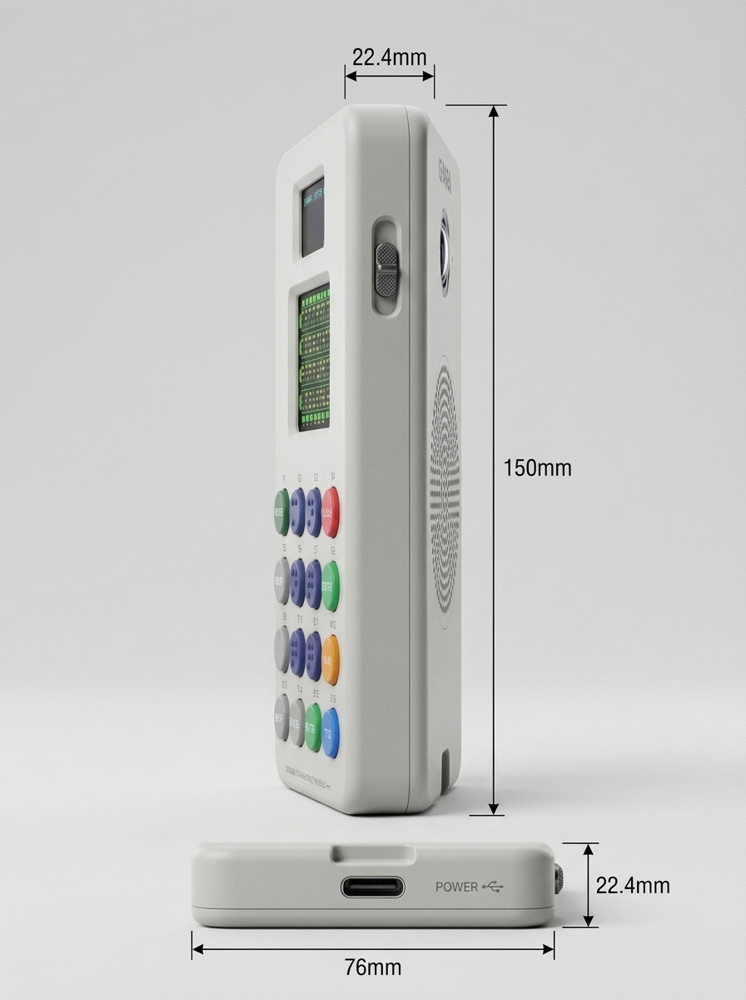
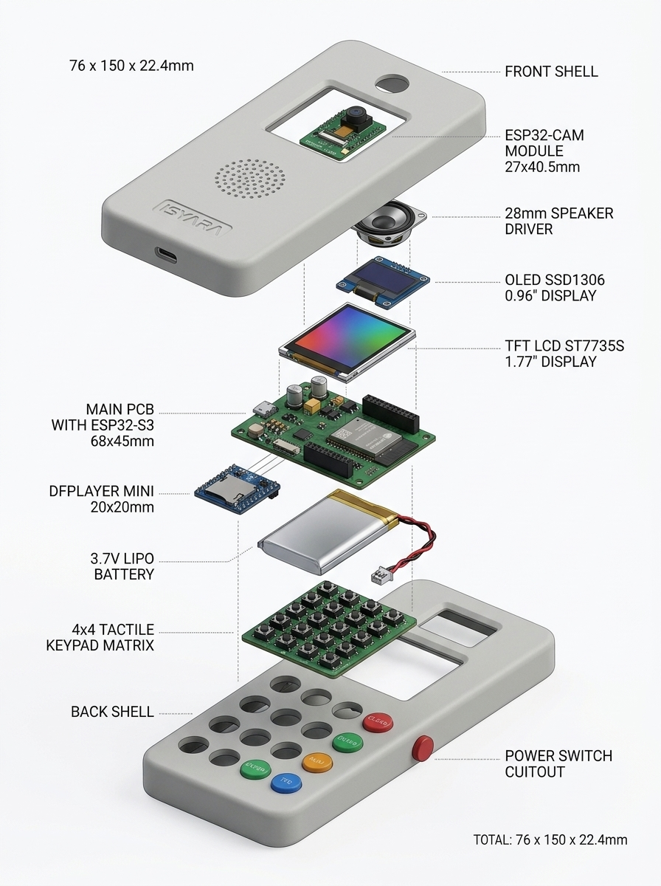
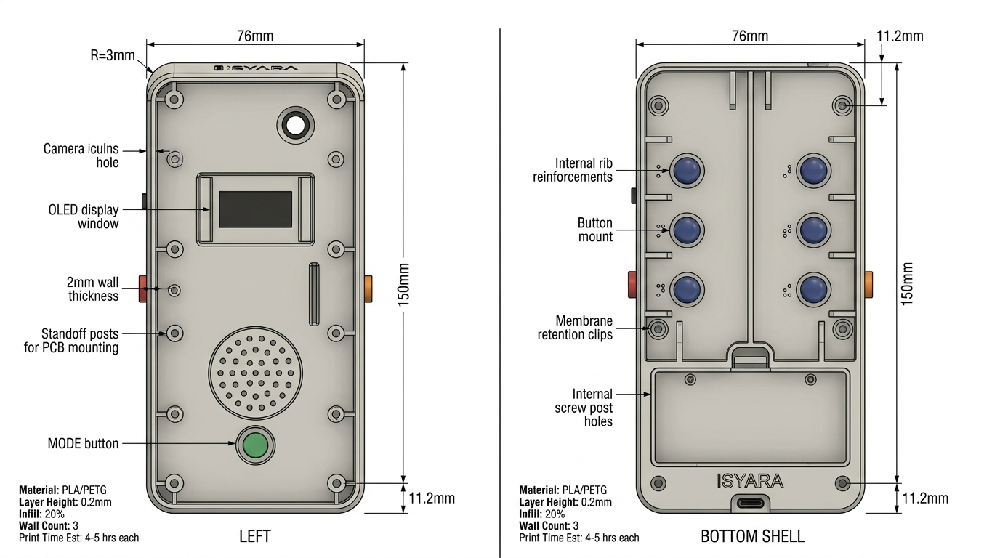

# 🏭 ISYARA V2 — 3D Print Design & Mockup Guide
## Layout Terkoreksi: 16-Button Keypad + Dual Display

---

## 📐 Spesifikasi Dimensi
| Parameter | Nilai |
|---|---|
| **Panjang** | 150 mm |
| **Lebar** | 76 mm |
| **Tebal Total** | 22.4 mm |
| **Tebal per Shell** | 11.2 mm |
| **Wall Thickness** | 2 mm |
| **Corner Radius** | R = 3 mm |
| **Material** | PLA / PETG |
| **Berat Est.** | ~85g (tanpa baterai) |

---

## 🎨 Hero Shot — Kedua Sisi



---

## 📱 Sisi User (Belakang) — Display + 16-Button Keypad



### Komponen Sisi User:
| Area | Komponen | Detail |
|------|----------|--------|
| **Atas** | OLED SSD1306 0.96" | Window 25×13mm, status dashboard |
| **Tengah** | TFT LCD ST7735S 1.77" | Window 36×29mm, Braille preview warna |
| **Bawah** | 16-Button Braille Keypad | Grid 4×4, tactile dome buttons |

### Layout Keypad 4×4 (S1-S16):
```
┌─────────┬─────────┬─────────┬─────────┐
│ S1      │ S2      │ S3      │ S4      │
│ 🟢 MODE │ 🔵 DOT 1│ 🔵 DOT 4│ 🔴 CLEAR│
├─────────┼─────────┼─────────┼─────────┤
│ S5      │ S6      │ S7      │ S8      │
│ ⚪ BKSP │ 🔵 DOT 2│ 🔵 DOT 5│ 🟢 ENTER│
├─────────┼─────────┼─────────┼─────────┤
│ S9      │ S10     │ S11     │ S12     │
│ ⚪ SPACE│ 🔵 DOT 3│ 🔵 DOT 6│ 🟠 NUM  │
├─────────┼─────────┼─────────┼─────────┤
│ S13     │ S14     │ S15     │ S16     │
│ ⚪ BKSP │ ⚪ SPACE│ 🟢 ENTER│ 🔷 TTS  │
└─────────┴─────────┴─────────┴─────────┘

Braille Cell: S2-S3 / S6-S7 / S10-S11 (6-dot di tengah)
```

---

## 📷 Sisi Depan (Menghadap Lawan Bicara) — Kamera + Speaker



### Komponen Sisi Depan:
| No | Komponen | Posisi | Keterangan |
|----|----------|--------|------------|
| 1 | **ESP32-CAM Lens** | Atas tengah | Lubang ⌀8mm + ring biru + LED indicator |
| 2 | **Speaker Grille** | Tengah | Pola lubang ⌀1.5mm, area ⌀30mm |
| 3 | **USB-C Port** | Edge bawah | Cutout 9×3.5mm |
| 4 | **Logo ISYARA** | Atas | Emboss halus |

---

## 📐 Tampak Samping — Dimensi & Switch



### Posisi Komponen Tepi:
| Sisi | Komponen | Detail |
|------|----------|--------|
| **Samping kanan** | Power Switch (ON/OFF) | Toggle switch slide, posisi atas |
| **Bawah** | USB-C Port | Charging + data, center |
| **Atas** | — | Smooth edge, rounded R=3mm |

---

## 🔧 Exploded View — Susunan Internal Lengkap



### Urutan Assembly (Front Shell → Back Shell):

| # | Komponen | Dimensi | Mount | Menghadap |
|---|----------|---------|-------|-----------|
| 1 | **Front Shell** | 76×150×11.2mm | — | Keluar (lawan bicara) |
| 2 | **ESP32-CAM** | 27×40.5×4.5mm | Recessed top mount | → Front (kamera keluar) |
| 3 | **Speaker 28mm** | ⌀28×5mm | Press-fit ke grille | → Front (suara keluar) |
| 4 | **OLED SSD1306** | 27×27×3mm | Rail guide slot | → Back (user lihat) |
| 5 | **TFT LCD ST7735S** | 42×36×3mm | Frame mount | → Back (user lihat) |
| 6 | **Main PCB + ESP32-S3** | 68×45×1.6mm | M2 standoff ×4 | Tengah |
| 7 | **DFPlayer Mini** | 20×20×5mm | Header ke PCB | Tengah |
| 8 | **3.7V LiPo Battery** | 50×30×8mm | Kompartemen recess | Bawah |
| 9 | **4×4 Keypad Matrix** | 60×60×1.5mm | PCB ke back shell | → Back (user tekan) |
| 10 | **Back Shell** | 76×150×11.2mm | 6× M2 screws | User-facing |

### Layer Stacking (Front → Back):
```
┌────────────────────────────────┐
│  FRONT SHELL (2mm) — Keluar    │ ← Camera + Speaker + USB-C
├────────────────────────────────┤
│  ESP32-CAM (4.5mm)    [Atas]   │
│  Speaker (5mm)        [Tengah] │
├────────────────────────────────┤
│  Main PCB + ESP32-S3  (1.6mm)  │ ← Otak sistem
│  DFPlayer Mini        (5mm)    │
│  LiPo Battery         (8mm)   │
├────────────────────────────────┤
│  OLED Display (3mm)   [Atas]   │ ← Menghadap user
│  TFT LCD (3mm)        [Tengah] │ ← Menghadap user
│  4×4 Keypad PCB (1.5mm)[Bawah] │ ← User tekan
├────────────────────────────────┤
│  BACK SHELL (2mm) — User-face  │ ← OLED/TFT window + 16 button holes
└────────────────────────────────┘
Total: ~22.4mm
```

---

## 🖨️ 3D Print Manufacturing Guide



### Print Settings
| Parameter | Front Shell | Back Shell | Button Caps |
|-----------|-------------|------------|-------------|
| **Orientasi** | Face-down flat | Face-down flat | Flange-down flat |
| **Material** | PLA / PETG | PLA / PETG | PLA (warna-warni) |
| **Layer Height** | 0.2mm | 0.2mm | 0.12mm (detail Braille) |
| **Nozzle** | 0.4mm | 0.4mm | 0.4mm |
| **Infill** | 20% Gyroid | 20% Gyroid | 100% Solid |
| **Wall Count** | 3 (1.2mm) | 3 (1.2mm) | 3 |
| **Support** | Ya (camera hole, grille) | Ya (button mounts, display windows) | Tidak perlu |
| **Est. Print Time** | ~4-5 jam | ~5-6 jam | ~30 menit (16 pcs) |
| **Est. Filament** | ~35g | ~45g | ~8g |

---

## 💾 File 3D CAD Siap Pakai (TinkerCAD, Slicer, & 3D Viewer)

Semua file 3D telah di-generate secara parametrik dengan geometri **100% Watertight (Manifold)**:

| File 3D | Format | Deskripsi | Ukuran |
|---|---|---|---|
| [`isyara_front_shell.stl`](file:///c:/Users/Acer%20Nitro%205/Documents/TUGAS%20SMK%20TELKOM/lomba/AITC%20UNAIR%202026/ISYARA/docs/3d_design/isyara_front_shell.stl) | STL (Binary) | Casing Depan (Kamera, Speaker Grille, USB-C) | ~302 KB |
| [`isyara_front_shell.obj`](file:///c:/Users/Acer%20Nitro%205/Documents/TUGAS%20SMK%20TELKOM/lomba/AITC%20UNAIR%202026/ISYARA/docs/3d_design/isyara_front_shell.obj) | OBJ | Casing Depan (TinkerCAD / Blender / 3D CAD) | ~204 KB |
| [`isyara_back_shell.stl`](file:///c:/Users/Acer%20Nitro%205/Documents/TUGAS%20SMK%20TELKOM/lomba/AITC%20UNAIR%202026/ISYARA/docs/3d_design/isyara_back_shell.stl) | STL (Binary) | Casing Belakang (OLED, TFT LCD, 16 Tombol, Switch) | ~354 KB |
| [`isyara_back_shell.obj`](file:///c:/Users/Acer%20Nitro%205/Documents/TUGAS%20SMK%20TELKOM/lomba/AITC%20UNAIR%202026/ISYARA/docs/3d_design/isyara_back_shell.obj) | OBJ | Casing Belakang (TinkerCAD / Blender) | ~243 KB |
| [`isyara_assembled_enclosure.stl`](file:///c:/Users/Acer%20Nitro%205/Documents/TUGAS%20SMK%20TELKOM/lomba/AITC%20UNAIR%202026/ISYARA/docs/3d_design/isyara_assembled_enclosure.stl) | STL (Binary) | Model Utuh Gabungan Kedua Casing (Presentasi) | ~650 KB |
| [`isyara_assembled_enclosure.obj`](file:///c:/Users/Acer%20Nitro%205/Documents/TUGAS%20SMK%20TELKOM/lomba/AITC%20UNAIR%202026/ISYARA/docs/3d_design/isyara_assembled_enclosure.obj) | OBJ | Model Utuh Gabungan Kedua Casing | ~452 KB |
| [`isyara_braille_button_cap.stl`](file:///c:/Users/Acer%20Nitro%205/Documents/TUGAS%20SMK%20TELKOM/lomba/AITC%20UNAIR%202026/ISYARA/docs/3d_design/isyara_braille_button_cap.stl) | STL (Binary) | Tombol tactile Braille dengan flange & dot timbul | ~20 KB |
| [`isyara_front_shell.scad`](file:///c:/Users/Acer%20Nitro%205/Documents/TUGAS%20SMK%20TELKOM/lomba/AITC%20UNAIR%202026/ISYARA/docs/3d_design/isyara_front_shell.scad) | OpenSCAD | Source script parametrik front shell | ~5.8 KB |
| [`isyara_back_shell.scad`](file:///c:/Users/Acer%20Nitro%205/Documents/TUGAS%20SMK%20TELKOM/lomba/AITC%20UNAIR%202026/ISYARA/docs/3d_design/isyara_back_shell.scad) | OpenSCAD | Source script parametrik back shell | ~6.8 KB |

---

## 🚀 Panduan Menggunakan File di Autodesk TinkerCAD

TinkerCAD adalah aplikasi CAD berbasis web dari Autodesk yang menggunakan format standar **STL** dan **OBJ**. Anda dapat meng-import file di atas langsung ke TinkerCAD:

### Langkah 1: Buka TinkerCAD
1. Buka browser dan kunjungi [tinkercad.com](https://www.tinkercad.com).
2. Login dengan akun Autodesk / Google Anda.
3. Klik tombol **+ Buat** (Create) > pilih **Desain 3D** (3D Design).

### Langkah 2: Import Model ISYARA
1. Di panel kanan atas TinkerCAD, klik tombol **Import**.
2. Pilih file dari komputer Anda:
   - Pilih [`isyara_front_shell.stl`](file:///c:/Users/Acer%20Nitro%205/Documents/TUGAS%20SMK%20TELKOM/lomba/AITC%20UNAIR%202026/ISYARA/docs/3d_design/isyara_front_shell.stl) atau [`isyara_back_shell.stl`](file:///c:/Users/Acer%20Nitro%205/Documents/TUGAS%20SMK%20TELKOM/lomba/AITC%20UNAIR%202026/ISYARA/docs/3d_design/isyara_back_shell.stl) (atau `isyara_assembled_enclosure.stl` untuk bentuk utuh).
3. Pastikan satuan diset ke **Milimeter (mm)** dan Skala **100%**.
4. Klik **Import**. Model 3D akan langsung muncul di atas Workplane!

### Langkah 3: Edit atau Beri Warna di TinkerCAD
- **Ubah Warna:** Klik objek di TinkerCAD, lalu pilih warna yang diinginkan (misalnya abu-abu gelap matte untuk casing, atau beri warna pada tombol).
- **Duplikasi Tombol:** Import `isyara_braille_button_cap.stl`, duplikasi menjadi 16 tombol, dan posisikan di lubang keypad dengan warna-warna Braille (biru, hijau, merah, kuning/oranye).
- **Tambah Teks / Label:** Gunakan shape **Text** di TinkerCAD jika ingin menambahkan nama tim atau nomor peserta lomba di permukaan casing.

### Langkah 4: Cara Mengirim Desain untuk Lomba (AITC UNAIR 2026)
1. Di kanan atas TinkerCAD, klik tombol **Kirim Ke** (Send To) atau **Bagikan** (Share).
2. Pilih **Bagikan Link Publik**:
   - Klik *Generate New Link* / *Salin Link*.
   - Link ini bisa langsung dicantumkan pada proposal atau dikirim ke juri/panitia lomba agar juri bisa melihat dan memutar model 3D secara interaktif di browser tanpa perlu install software apapun!
3. Atau klik **Export** > pilih **.STL** atau **.GLTF** untuk dilampirkan dalam berkas pengumpulan lomba.

---

## 👁️ Preview Cepat di Windows (Tanpa Perlu Internet)
Anda juga bisa langsung melihat file 3D ini di laptop Anda sekarang:
1. Buka File Explorer ke folder [`docs/3d_design/`](file:///c:/Users/Acer%20Nitro%205/Documents/TUGAS%20SMK%20TELKOM/lomba/AITC%20UNAIR%202026/ISYARA/docs/3d_design).
2. **Double-click** file [`isyara_assembled_enclosure.stl`](file:///c:/Users/Acer%20Nitro%205/Documents/TUGAS%20SMK%20TELKOM/lomba/AITC%20UNAIR%202026/ISYARA/docs/3d_design/isyara_assembled_enclosure.stl) atau [`isyara_back_shell.stl`](file:///c:/Users/Acer%20Nitro%205/Documents/TUGAS%20SMK%20TELKOM/lomba/AITC%20UNAIR%202026/ISYARA/docs/3d_design/isyara_back_shell.stl).
3. Aplikasi bawaan **3D Viewer** Windows akan otomatis terbuka dan Anda bisa langsung memutar, memperbesar, serta melihat seluruh detail casing!
